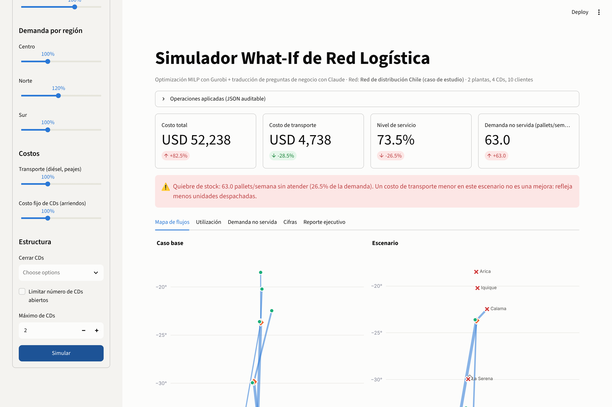
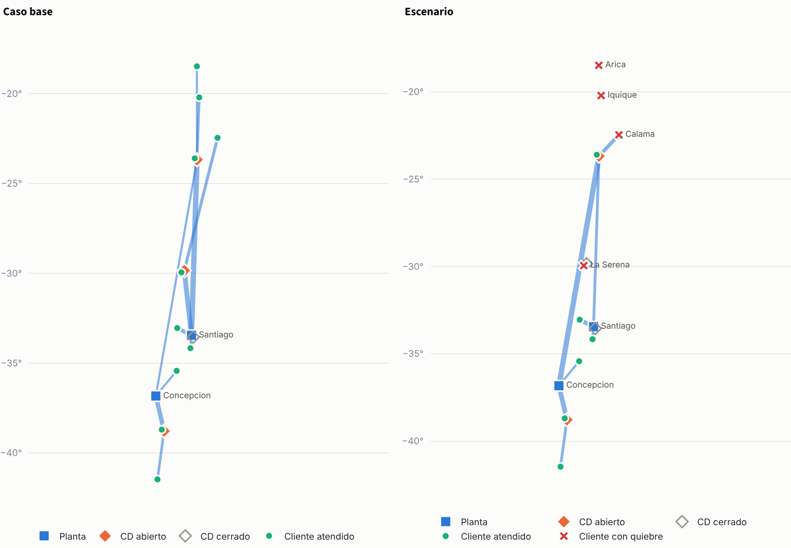

# Agente de Optimización de Red Logística

[](https://github.com/CastilloFelipe/supply-chain-agent/actions/workflows/tests.yml)
[](https://llm-supply-chain-agent.streamlit.app/)


[](LICENSE)

Simulador *what-if* para redes de distribución que combina **optimización matemática
(MILP en Gurobi)** con un **LLM (Claude)** que entiende preguntas de negocio:

> "¿Qué pasa con el costo si la planta de Santiago reduce su capacidad a la mitad y la
> demanda del norte aumenta un 20%?"

El sistema traduce la pregunta a cambios sobre el modelo, lo resuelve con Gurobi y entrega
un reporte ejecutivo. **Todas las cifras las calcula el optimizador**: el LLM solo traduce
e interpreta.



## Lo destacado

- **Modelo validado contra la literatura.** Reproduce exactamente los óptimos publicados
  de las instancias OR-Library de Beasley (cap41, cap71, cap101).
- **Traductor evaluado a ciegas.** 70 preguntas en tres sets de dificultad creciente,
  traducidas por un agente sin acceso a las respuestas. Los fallos del v2 llevaron a
  mejoras que se midieron con un v3 nuevo (detalle abajo).
- **El LLM no ejecuta código.** Cada cambio es una herramienta con esquema estricto, y los
  nombres válidos (plantas, CDs, clientes, regiones) salen de los datos. Un escenario es un
  JSON auditable que se puede volver a ejecutar sin el LLM.
- **Lectura correcta de las cifras.** Si un escenario deja demanda sin atender, el costo de
  transporte baja; el sistema lo advierte en vez de presentarlo como un ahorro. Además
  avisa cuando un escenario no cambia nada respecto del caso base.
- **Tres formas de uso:** demo web sin LLM, Claude Code (sin API key) o API de Anthropic.

## Inicio rápido

```bash
git clone https://github.com/CastilloFelipe/supply-chain-agent
cd supply-chain-agent
python -m venv .venv && source .venv/bin/activate
pip install -r requirements.txt
```

| Quiero... | Comando | Requiere |
|---|---|---|
| Ver la demo web | `streamlit run app/streamlit_app.py` | nada (modo manual) |
| Correr el escenario de ejemplo | `python main.py` | nada |
| Hacer una pregunta con Claude Code | `/what-if ¿Qué pasa si cerramos el CD de La Serena?` | Claude Code |
| Hacer una pregunta con la API | `python main.py --pregunta "..."` | `ANTHROPIC_API_KEY` |
| Correr los tests | `pytest` | nada |

`gurobipy` trae una licencia restringida (2000 variables), suficiente para la red de Chile
y la mayoría de los benchmarks. Para instancias grandes se usa una licencia académica.

## Cómo funciona

```
Pregunta de negocio
      │
      ▼
[LLM] Traductor ─────────► operaciones JSON (herramientas con esquema estricto)
  contexto: red + solución base + reglas          │
                                                  ▼
NetworkData (copia) ──► modelo MILP ──► Gurobi ──► solución del escenario
                                                  │
           caso base ◄──── comparación (Python) ──┘
                                │  nivel de servicio, costo por unidad servida,
                                │  cuellos de botella, cambios de flujo
                                ▼
[LLM] Redactor ──► reporte ejecutivo  +  tabla de cifras (generada en código)
```

### Formulación

Red de tres niveles: plantas → centros de distribución (CD) → clientes.

min Σ c_ij·x_ij + Σ fix_d·y_d + P·Σ u_c

| Restricción | Expresión |
|---|---|
| Capacidad de planta | Σ_j x_fj ≤ cap_f |
| Conservación de flujo en CD | Σ_i x_id = Σ_j x_dj |
| Capacidad de CD (si opera) | Σ_i x_id ≤ cap_d · y_d |
| Demanda | Σ_i x_ic + u_c = dem_c |
| Máximo de CDs (escenario) | Σ_d y_d ≤ N |
| CD obligado (escenario) | y_d = 1 |
| Ruta bloqueada (escenario) | x_ij = 0 |

`u_c` es la demanda no servida, con penalización P. Gracias a ella un escenario severo no
termina en "INFEASIBLE": el modelo entrega cuántas unidades faltan y en qué clientes.

### Qué se puede preguntar

| Tipo de cambio | Ejemplo |
|---|---|
| Capacidad de planta o CD | "¿Y si la planta de Santiago produce a la mitad?" |
| Demanda por región o cliente | "¿Y si la demanda de Arica sube 10 pallets?" |
| Costos de transporte | "¿Y si el diésel sube 15%?" |
| Costos fijos de CDs | "¿Y si los arriendos suben 10%?" |
| Cierre u operación obligada de CDs | "¿Y si cerramos La Serena pero mantenemos Santiago?" |
| Consolidación | "¿Y si operamos máximo 2 CDs?" |
| Cortes de ruta | "¿Y si se corta la ruta a Arica?" |

Lo que el modelo no representa (tiempos de tránsito, tipo de cambio, ubicaciones nuevas)
se declara explícitamente en vez de aproximarse.

## Resultados

### Validación del modelo (OR-Library)

Instancias *Capacitated Warehouse Location* de la
[OR-Library](http://people.brunel.ac.uk/~mastjjb/jeb/orlib/capinfo.html) (J.E. Beasley),
que tienen óptimos publicados. `tests/test_orlib_benchmark.py` exige reproducirlos.

| Instancia | Bodegas × clientes | Óptimo publicado | Este modelo |
|---|---|---:|---:|
| cap41  | 16 × 50 | 1,040,444.375 | 1,040,444.375 |
| cap71  | 16 × 50 |   932,615.750 |   932,615.750 |
| cap101 | 25 × 50 |   796,648.437 |   796,648.438 |
| cap131 | 50 × 50 |   793,439.562 | requiere licencia académica |

### Evaluación del traductor

Cada set (`evals/<set>/`) separa las preguntas de las respuestas esperadas. La traducción
la hace un agente de Claude Code que no puede ver las respuestas, y
`evals/run_eval.py` compara las operaciones: sin importar el orden, con tolerancia en los
factores y exigiendo declarar lo no modelable.

| Set | Qué prueba | Corrida | Aciertos |
|---|---|---|---|
| v1 | Cambios básicos, ambigüedad, trampas de porcentaje ("se reduce en 30%" = 0,7) | v1-ciega-01 | 22 / 22 |
| v2 | Cantidades absolutas, lenguaje coloquial ("Norte Grande"), crecimiento compuesto, contradicciones, preguntas de optimización, OR-Library | v2-ciega-01 | 22 / 24 |
| v3 | Creado después de las mejoras: decisiones del optimizador, objetivos imposibles de imponer, cambios sin efecto, cantidades por región, lugares inexistentes | v3-ciega-01 | 24 / 24 |
| v2 (repetición) | Mismo v2 con el traductor mejorado (no es una medición independiente) | v2-ciega-02 | 24 / 24 |

**Qué se aprendió.** En el v2 el traductor falló en dos casos de criterio. No declaró que
"cerrar todos los CDs pero atender a todos" impone un resultado que el modelo no puede
garantizar. Y ante "¿qué CD conviene cerrar?" agregó "máximo 3 CDs" cuando el caso base ya
operaba con 3, un cambio sin efecto. La causa era que el traductor no conocía la solución
base. Se corrigió agregando esa solución a su contexto, dos reglas nuevas y un aviso de
escenario sin efecto. Para no medir la mejora con las mismas preguntas que la motivaron se
creó el v3.

**Limitaciones.** Son sets chicos (22 a 24 casos) sobre una red pequeña con nombres
cerrados; un 100% no garantiza el mismo resultado con redes reales. En tres casos del v3
se aceptan dos respuestas, porque modelar o no un cambio sin efecto da el mismo resultado.
Las corridas usan Claude Code como traductor; el modo API usa el mismo prompt y las
mismas herramientas, pero todavía no se ha medido con `run_eval.py --api`.

### Ejemplo de reporte

Para "¿Qué pasa si cerramos el CD de La Serena y el diésel sube 15%?"
([escenario](docs/ejemplo_escenario.json), [reporte completo](docs/ejemplo_reporte.md)),
el sistema concluye que el cierre **no ahorra costo fijo**: obliga a abrir el CD Santiago.
El CD Antofagasta queda como cuello de botella al 100% y 20 pallets semanales del extremo
norte quedan sin atender. El costo de transporte baja 11,9% pese al alza del diésel, solo
porque se dejan de hacer los despachos más largos.



## Formas de uso

### Demo web

**App en línea:** https://llm-supply-chain-agent.streamlit.app/

```bash
streamlit run app/streamlit_app.py
```

- **Escenario manual:** controles deslizantes para la capacidad de plantas, la demanda por
  región, los costos, el cierre de CDs y la consolidación. No usa el LLM.
- **Pregunta a Claude:** traduce la pregunta y redacta el reporte. Requiere `ANTHROPIC_API_KEY`.
- **Vistas:** KPIs, mapa georreferenciado (base vs escenario), utilización, quiebres por
  cliente, tabla de cifras y reporte descargable.

**Publicarla en Streamlit Community Cloud:** en [share.streamlit.io](https://share.streamlit.io)
→ *Create app* → repositorio `CastilloFelipe/supply-chain-agent`, rama `main`, archivo
`app/streamlit_app.py`, Python 3.12. La versión pública funciona sin API key: el modo manual
completo, las instancias OR-Library y, en el modo *Pregunta a Claude*, un ejemplo real de
pregunta traducida y su reporte que se puede cargar en el simulador. La licencia restringida
de `gurobipy` alcanza para todas las redes salvo cap131.

### Claude Code, sin API key

Los skills del repositorio (`.claude/skills/`) dejan a Claude Code como traductor y
redactor:

```
/what-if ¿Qué pasa si se corta la ruta a Arica y la demanda del sur sube 10%?
/evaluar-traductor
```

Por debajo, `python main.py --catalogo` entrega el mismo contexto que recibe el modo API
(reglas, red, solución base y herramientas). `python main.py --escenario <archivo.json>`
valida el escenario con el mismo esquema y lo resuelve, y `scripts/componer_reporte.py`
arma el reporte.

### API de Anthropic

```bash
export ANTHROPIC_API_KEY=sk-ant-...
python main.py --pregunta "¿Qué pasa si cerramos el CD de La Serena y el diésel sube 15%?"
python main.py --datos data/orlib/cap101.json --pregunta "¿Y si cerramos la bodega B006?"
python evals/run_eval.py --set v3 --api
```

El traductor usa *tool use*: si una llamada no pasa la validación, el error vuelve a Claude
para que la corrija. Activa además el respaldo automático del servidor ante rechazos.

## Estructura

```
├── main.py                       # CLI: caso base, escenarios, catálogo, preguntas
├── app/                          # Demo web (Streamlit + Plotly)
├── src/network_opt/              # Modelo de optimización
│   ├── data.py                   #   carga y validación de la red
│   ├── model.py                  #   MILP en gurobipy
│   └── scenario.py               #   operaciones what-if permitidas
├── src/whatif_agent/             # Capa LLM
│   ├── tools.py                  #   herramientas con enums desde los datos
│   ├── translator.py             #   pregunta -> operaciones (API)
│   ├── offline.py                #   escenarios traducidos fuera del programa
│   └── report.py                 #   comparación y reporte ejecutivo
├── data/                         # Red de Chile + instancias OR-Library
├── evals/                        # Sets v1-v3, predicciones y resultados
├── scripts/                      # Conversor OR-Library, composición de reportes
├── tests/                        # pytest (CI en GitHub Actions)
└── .claude/skills/               # /what-if y /evaluar-traductor para Claude Code
```

## Próximos pasos

- Medir el modo API con `run_eval.py --api`.
- Construir una red a partir de datos reales de pedidos (p. ej. DataCo Smart Supply Chain).
- Agregar ubicaciones candidatas para preguntas del tipo "¿y si abrimos un CD en Copiapó?".
- Publicar la demo en Streamlit Community Cloud.

## Licencia y datos

Código bajo licencia [MIT](LICENSE). Las instancias OR-Library pertenecen a sus autores y
se redistribuyen convertidas, citando la fuente (ver [data/orlib](data/orlib/README.md)).
